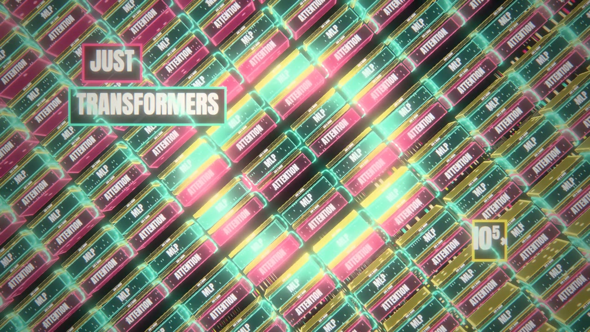
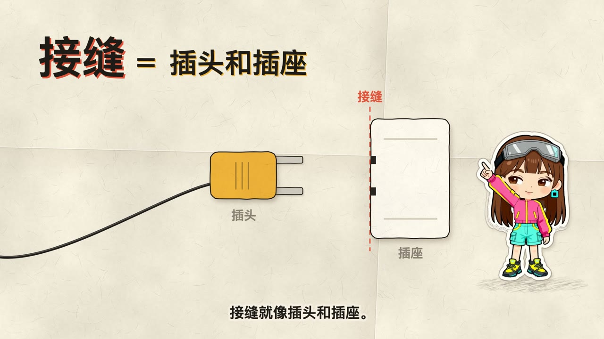

# ai_video

一个中文科普动画系列，外加一支 MV《I'm Upping My P(doom)》。

所有画面都是 **Claude（Opus 5.5）在 Claude Code 里写的代码**：每个页面都是一段 HTML/JS，画面是时间 `t` 的纯函数，由渲染器逐帧截图，再用 ffmpeg 合成 MP4。整个项目由多个 Claude agent 分工协作完成：有的写分镜，有的写镜头代码，有的做素材、做检查，再由一个 supervisor agent 派活和验收。

| | |
| --- | --- |
|  |  |
| MV《I'm Upping My P(doom)》副歌 | MV 桥段 |
|  | |
| 科普 ep01「接缝层」 | |

项目约定（页面接口、节奏参数、开头留存规则、风格底线）写在 [CLAUDE.md](CLAUDE.md)。它同时也是给 agent 的工作手册。prompt 写法见 [docs/prompt-playbook.md](docs/prompt-playbook.md)。

## 目录

```
CLAUDE.md            项目约定
docs/                调研笔记、prompt 手册、配音方法、README 截图（docs/images/）
templates/           新一集的起手文件：brief.md、script.md、index.html
tools/
  render/            确定性渲染器（Playwright 逐帧 seek + 截图 → ffmpeg）
  tts/               旁白：script.md → edge-tts 分段音频 + timings.json
  cover/             封面导出
  imggen/            本地生图 / 图生视频服务（ComfyUI 外包 REST）的客户端、服务端和说明
  layers/            立绘分层、抠图、关节标注
  face-bake/         3D 头模的表情贴花烘焙
  paperclip-bake/    回形针刚体物理烘焙（Rapier）
  dt/                3D 模型生成（Tripo 等）、模型清单、查看器检查
assets/
  fonts/             开源字体（OFL，每个目录带 OFL.txt）
  vendor/three/      three.js r170 + 用到的 examples/jsm 模块（MIT）
  lib/               跨集共享的 JS，例如纸片女孩讲解员 paper-girl.js
  characters/        讲解员角色素材（girl-q：Q 版纸片女孩的身体动作和头部表情切图）
episodes/
  ep01-…ep08-…/      科普系列：每集 brief.md、script.md、index.html、cover/
  mv-pdoom/          MV：engine/（时间轴、歌词、调色）、shots/（各段镜头）、kits/（three.js 场景部件）、
                     fresh/（各段定稿用到的分层图、i2v 序列）、tools-final/（拼成片）、各段 *.html 页面
  cast-cyber-girl/   MV 女主的设定图、近景分层（closeup/）、3D 查看器（3d/）
samples/             风格样片（Three.js 黏土定格 + Web Audio 合成配乐等）
```

## 环境

- Node ≥ 20、Python 3、ffmpeg / ffprobe（`brew install ffmpeg`）
- `pip install edge-tts`：生成旁白要联网请求微软 TTS。
- `npm install`：安装 Playwright 1.62.0 和 Rapier。缺 chromium 时运行 `npx playwright install chromium`。
- 部分 Python 工具需要 Pillow / numpy：`pip install pillow numpy`。

所有页面都要从**项目根目录**起静态服务器来访问，因为页面用绝对路径引用 `assets/`：

```sh
python3 -m http.server 8000
# 浏览器打开 http://localhost:8000/episodes/ep01-seam-layer/
```

## 科普系列：从 0 到 MP4

```sh
EP=episodes/ep01-slug

# 1. 建目录，复制起手文件
mkdir -p $EP
cp templates/brief.md templates/script.md templates/index.html $EP/

# 2. 写 brief.md（事实清单要带来源），再写 script.md（每段 `## id` + `旁白：` + `画面：`）

# 3. 生成旁白：narration/seg-<id>.mp3、narration.mp3、timings.json
python3 tools/tts/tts.py $EP
#    可选参数：--voice zh-CN-XiaoxiaoNeural  --rate -5%  --pause 0.4  --lead 0  --tail 0.6
#    改了讲稿就重跑；文本没变的段复用缓存，不重新请求（--force 强制重来）

# 4. 写 index.html：时间轴用 seg('s01').start / .end，不手写秒数
#    预览：空格播放/暂停（跟着旁白走），← → 跳 2 秒，点进度条跳转

# 5. 自查：半分辨率、每秒 1 帧，拼成 out/contact-sheet.png
node tools/render/render.mjs $EP --preview
#    只渲染一段看节奏，输出 out/clip-<from>-<to>.mp4
node tools/render/render.mjs $EP --from 20 --to 35

# 6. 全量渲染：输出 out/final.mp4（1080p30、H.264 yuv420p，合上 narration.mp3）
#    配乐：页面提供 window.__video.renderAudio()（返回 WAV）时用它，否则用目录里的 music.wav；
#    和旁白同时存在时，按原电平相加混音
node tools/render/render.mjs $EP
#    合成成功后默认删掉 out/frames/；要保留就加 --keep-frames
```

仓库里**不带旁白音频**。克隆后，对每一集先跑一次 `python3 tools/tts/tts.py episodes/epNN-…` 生成 `narration/`，页面才能预览和渲染。

### 渲染器参数

`node tools/render/render.mjs <dir> [--preview [--step s]] [--page f.html] [--from s] [--to s] [--workers n] [--keep-frames] [--gpu]`

- `--page f.html`：渲染目录里的另一个页面（而不是 `index.html`），产物名前面带页名。
- `--gpu`：开启 GPU 合成，three.js 重场景用。
- 页面接口：`window.__video = { width, height, fps, duration, seek(t) }`。`seek(t)` 要同步把画面画到第 t 秒。URL 带 `?render=1` 时页面不自动播放。

**确定性**：同一台机器、同一 `--workers`（默认 4）下，两次渲染逐帧 md5 相同。改 `--workers` 会让文字边缘出现 1–3 个色阶的差异，肉眼看不出来。

### 冒烟测试

```sh
python3 tools/tts/tts.py tools/render/fixtures/pipeline-test
node tools/render/render.mjs tools/render/fixtures/pipeline-test
node tools/render/render.mjs tools/render/fixtures/pipeline-test --preview
```

## MV《I'm Upping My P(doom)》

整首歌约 157 秒，按段落拆成几个页面分别渲染，最后拼起来。

| 时间 | 段落 | 页面 |
| --- | --- | --- |
| 0–22.5 s | 开头 + 主歌 1 | `v4-01-final.html`（`--from 0 --to 22.5`） |
| 22.5–38.4 s | 副歌 1 | `c1-v4.html` |
| 38.4–58.4 s | 主歌 2 + 预副歌 2 | `v4-03.html`（`--from 0 --to 20`） |
| 58.4–74.8 s | 副歌 2 | `c2-v4.html` |
| 74.8–95.4 s | 主歌 3 + 预副歌 3 | `v3-v4.html`，产物改名为 `v3-v7.mp4` |
| 95.4–106 s | 副歌 3 | `c3-v7.html` |
| 106–123.9 s | 桥段 | `br-v5.html` |
| 123.9 s–结尾 | 副歌 4 + 尾声 | `c4-v4.html` |

```sh
# 先补齐下面「仓库里没有的东西」里的音乐、歌词时间轴和烘焙数据
node tools/render/render.mjs episodes/mv-pdoom --page c1-v4.html --gpu
# 预览：每个页面都有一个 *-half.html 半分辨率版本
# 全部段落渲完后拼成片（段表见脚本开头的 SEGMENTS），产物是 out/final.mp4
cd episodes/mv-pdoom && python3 tools-final/build_final.py
```

分镜和设定见 `episodes/mv-pdoom/TREATMENT.md`、`STORYBOARD-v4.md`、`MOCAP.md`。各段之间的衔接表见 `fresh/v4-rest/CONTINUITY.md`。`index.html`、`v1.html` 等是早期版本，代码留作参考，但它们用到的素材图没有入库。

## 仓库里没有的东西，以及怎么补

为了控制体积和遵守授权，下面这些没有入库（规则见 [.gitignore](.gitignore)）。

| 缺什么 | 放在哪 | 怎么补 |
| --- | --- | --- |
| **歌曲音频** | `episodes/mv-pdoom/music.mp3` | 版权归原作者，见下方「第三方素材与授权」。自备音频后放到这个位置。`data/audio.json`（节拍、段落、响度分析）已入库，它对应的是这首歌的 Claude-Pop 版。 |
| **歌词时间轴** | `episodes/mv-pdoom/data/lyrics.json` | 歌词版权归原作者。格式和生成方法见下一节。 |
| **中文意译** | `episodes/mv-pdoom/data/lyrics-zh.json` | 里面逐句带着英文原句，所以一并不入库。只有旧版引擎用它。 |
| **旁白音频** | 各集 `narration/` | 由 edge-tts 生成：`python3 tools/tts/tts.py <集目录>`。 |
| **角色 / 猫咪 3D 模型**（`.glb`） | `episodes/cast-cyber-girl/3d/tripo-girl/`、`3d/cat/` 等 | 用 Tripo 等工具由设定图生成（脚本见 `tools/dt/tripo.py`、`tools/dt/hy3d.py`）。放回去之后，运行 `python3 tools/dt/list-models.py episodes/cast-cyber-girl/3d` 更新 `models.json`。MV 的定稿段主要用 2D 分层图，3D 模型只在早期版本和动捕实验里用到。 |
| **Mixamo 动作**（`.fbx`） | `episodes/cast-cyber-girl/3d/anim/mixamo/` | Adobe 条款不允许单独再分发。需要的动作名单见同目录的 `_files.json`，在 [mixamo.com](https://www.mixamo.com) 登录后下载，按名单里的文件名保存。 |
| **回形针物理烘焙数据**（`*.bin.gz`） | `episodes/mv-pdoom/kits/paperclip-phys/` | `node tools/paperclip-bake/bake.mjs tower` 和 `node tools/paperclip-bake/bake.mjs pile`。需要先 `npm install` 装好 Rapier。 |
| **本地生图服务** | 局域网里的一台 GPU 机器 | 服务端代码、模型清单和部署说明见 [tools/imggen/README.md](tools/imggen/README.md)。客户端是 `tools/imggen/client.py`，里面的服务地址和取 token 的方式要改成你自己的。只有重新生成素材时才需要它，渲染不需要。 |
| **所有视频和渲染产物** | 各级 `out/`、`frames/`、`preview*/` | 按上面的方法重新渲染。 |
| 没被定稿用到的生成图（候选角色、旧版关键画、分镜草图、中间件），真人参考照片、调研抽帧 | `closeup/`、`fresh/`、`kits/` 下的大部分图片，`cast-cyber-girl/refs/`、`research/skillry/`、各级 `_work/` | 本地留存，不公开。仓库只保留定稿页面实际加载的素材图，以及角色设定和参考图（`turnaround/`、`style/`、`puppet/`、`rig-demo/`、`cats/`）。所以早期版本的页面（`index.html`、`v1.html`、`c1.html` 等）打开后会缺图。 |

### `lyrics.json` 的格式

```jsonc
{
  "lines": [                                  // 46 行，按演唱顺序
    {
      "i": 0,                                 // 行号
      "text": "…",                            // 这一行歌词
      "start": 1.41, "end": 4.62,             // 秒，以 music.mp3 的无间隙解码为时间零点
      "words": [
        { "w": "…", "start": 1.41, "end": 1.70,
          "conf": 0.93,                       // 对齐置信度
          "syl": [[1.41, 1.55], [1.55, 1.70]] // 可选：多音节词的逐音节起止时间
        }
      ]
    }
  ],
  "extras": [ { "start": 0, "end": 0, "desc": "…" } ],  // 非歌词人声（和声、喊声等）
  "notes": "…"                                          // 生成方法说明
}
```

引擎（`engine/lyrics.js`）按 `lines[].start/end` 换行，按 `words[].start/end` 逐词点亮，有 `syl` 时按音节点亮。

生成方法（逐词强制对齐）：

1. 用 Demucs 分离人声，人声轨整体平移 −23 ms，对齐到 mp3 的无间隙解码。
2. 用 torchaudio 的 `MMS_FA` 和 `wav2vec2-large-lv60k-960h` 对人声轨（单声道和左右声道）分别算出 CTC 发射概率，再融合。
3. 按已知歌词做全局约束 Viterbi 强制对齐。加一个"垃圾"星号 token 吸收非歌词人声；缩写词用发音拼写（例如把 P(doom) 写成 "pee doom"）。
4. 逐音节细化起点。
5. 用 `mlx-whisper large-v3-turbo` 和 mel-roformer karaoke 人声轨做交叉校验。
6. 人工逐句核对，修正约 20 处。

只想把 MV 跑起来的话，也可以先手写一个只有 `lines[].start/end/text`、`words` 粗分的文件，画面能出来，只是逐词点亮会不准。

## 第三方素材与授权

本仓库的代码和原创素材以 [MIT License](LICENSE) 发布。以下内容不在 MIT 范围内，各自遵守原许可：

- **歌曲《I'm Upping My P(doom)》**：词作者 osmarks，基于 MusicPerson 写的主歌和副歌，部分歌词来自 EleutherAI Discord；原版于 2024 年用 Udio 生成；MV 所用的 Claude-Pop 版由 deckard（@slimer48484）用 Suno 制作。版权归原作者，本仓库不包含音频和歌词时间轴。
- **three.js**（`assets/vendor/three/`）：MIT License，见该目录下的 `LICENSE`。
- **字体**（`assets/fonts/`）：Anton、Bebas Neue、Bungee、Caveat、Fraunces、Kalam、Pacifico、Share Tech Mono，均为 SIL Open Font License 1.1，见各目录下的 `OFL.txt`。
- **Mixamo 动作**：来自 Adobe Mixamo，按其服务条款可以用在作品里，但不能单独再分发动作文件，所以没有入库。
- **生图 / 图生视频模型**：素材图和 i2v 序列中有一部分由以下模型生成，模型本身不在仓库里。
  - Qwen-Image / Qwen-Image-Edit（含 Lightning 加速 LoRA）：Apache License 2.0
  - Wan 2.2（I2V / T2V A14B，含 lightx2v 蒸馏 LoRA）：Apache License 2.0
  - LTX-2.5（Lightricks）：LTX-2.x Community License，见其官方许可证 <https://github.com/Lightricks/LTX-2/blob/main/LICENSE-2_x>
  - BiRefNet（抠图）：MIT License
  - 少量早期素材用了阿里云百炼（DashScope）上的千问云端模型
- **旁白**：微软 Edge TTS（edge-tts）生成，没有入库。
